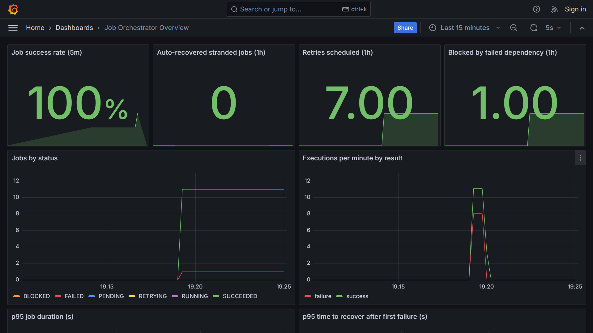
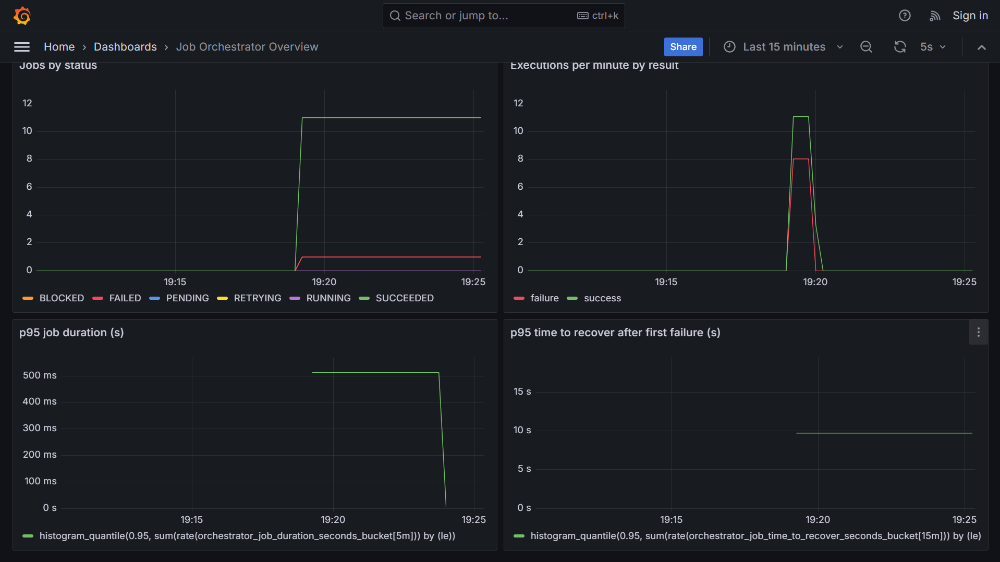

# Self-Healing Job Orchestrator

A small job-scheduling service that **detects failures and heals them automatically**, and exposes
what it is doing through Prometheus metrics and a Grafana dashboard.

Jobs are queued through a REST API. A background worker runs them, retries transient failures with
exponential backoff, recovers jobs stranded by a crashed worker, and blocks (then later unblocks)
jobs whose dependencies fail.

```
                +-------------------+        +--------------------+
  REST API ---> |  FastAPI service  | -----> |  PostgreSQL / SQLite|
  (create, list,|  /jobs /stats     |        |  (job store)        |
   retry)       |  /metrics /health |        +--------------------+
                +---------+---------+
                          |  background worker (tick every N s)
                          v
                +-------------------+      scrape      +------------+     +---------+
                |   Orchestrator    | ---------------> | Prometheus | --> | Grafana |
                | retry / recover / |    /metrics      +------------+     +---------+
                | dependency logic  |
                +-------------------+
```

## Dashboard

Grafana dashboard fed by the service's Prometheus metrics (success rate, retries, blocked jobs,
status counts, latency and time-to-recover). Demo jobs include transient failures that heal through
retries, a pipeline, and a permanent failure that blocks its dependant.




## What it does

| Behaviour | How it works |
|---|---|
| **Retries with backoff** | A failed job is retried after `base * 2^(attempt-1)` seconds, up to `max_retries`, then marked `FAILED`. |
| **Stranded-job recovery** | A job stuck in `RUNNING` longer than the timeout (for example because the worker crashed) is reset and run again. |
| **Dependencies** | A job runs only after the job it `depends_on` has succeeded. Dependencies must already exist, so cycles cannot be created. |
| **Failure containment** | If a dependency fails permanently, its dependants become `BLOCKED`. When the dependency is fixed and retried, they are unblocked automatically. |
| **Observability** | Success rate, retries, recoveries, blocked jobs, job duration, time-to-recover and per-status counts are exported to Prometheus and charted in Grafana. |

Jobs reference **named tasks** (`echo`, `sleep`, `flaky`, `always_fail`) from a registry, so the API
never runs arbitrary code or shell commands. Add your own in `app/tasks.py`.

## Project layout

```
app/core.py        scheduling + self-healing engine (no third-party dependencies)
app/sql_store.py   SQLAlchemy job store (SQLite by default, PostgreSQL in Docker)
app/metrics.py     Prometheus metrics
app/main.py        FastAPI app and background worker
app/tasks.py       built-in demo tasks
tests/             unit tests (core engine, SQL store, API)
monitoring/        Prometheus config and provisioned Grafana dashboard
scripts/demo.py    creates sample jobs for the dashboard
```

The core engine is kept free of web and database code on purpose, so the retry, recovery and
dependency rules can be unit tested quickly with an in-memory store.

## Run it

### With Docker (API + PostgreSQL + Prometheus + Grafana)

```bash
docker compose up --build
python scripts/demo.py          # creates sample jobs
```

- API and docs: http://localhost:8000/docs
- Prometheus: http://localhost:9090
- Grafana dashboard (opens on your machine once the stack is running): http://localhost:3000/d/orchestrator-overview/job-orchestrator-overview?refresh=5s

### Locally (SQLite)

```bash
python -m venv .venv && source .venv/bin/activate
pip install -r requirements-dev.txt
uvicorn app.main:app --reload
```

## API

```bash
# create a job that fails twice and then succeeds
curl -X POST localhost:8000/jobs -H 'Content-Type: application/json' \
  -d '{"name":"demo","task":"flaky","params":{"fail_times":2}}'

# create a job that depends on another
curl -X POST localhost:8000/jobs -H 'Content-Type: application/json' \
  -d '{"name":"child","task":"echo","depends_on_id":1}'

curl localhost:8000/jobs            # list (filter with ?status=FAILED)
curl localhost:8000/jobs/1          # one job, with attempts and last_error
curl -X POST localhost:8000/jobs/1/retry   # re-queue a FAILED or BLOCKED job
curl localhost:8000/stats           # job counts per status
curl localhost:8000/metrics         # Prometheus metrics
```

| Method | Path | Purpose |
|---|---|---|
| POST | `/jobs` | Create a job |
| GET | `/jobs`, `/jobs/{id}` | List or fetch jobs |
| POST | `/jobs/{id}/retry` | Re-queue a `FAILED` or `BLOCKED` job |
| GET | `/stats` | Count of jobs per status |
| POST | `/admin/tick` | Run one scheduling pass immediately |
| GET | `/health`, `/metrics` | Health check and Prometheus metrics |

Configuration (environment variables): `DATABASE_URL`, `TICK_SECONDS`, `BACKOFF_BASE_SECONDS`,
`STRANDED_TIMEOUT_SECONDS`, `DISABLE_WORKER`.

## Tests and CI

```bash
pytest -v
```

GitHub Actions runs the test suite and builds the Docker image on every push and pull request.

## Failure simulation

`scripts/simulate.py` pushes 1,000 jobs through the orchestrator with a fake clock and an in-memory
store (no database or server needed): 70% healthy, 25% flaky (fail once or twice, then succeed) and
5% that always fail. With the default seed it reports:

```
Transient failures healed automatically: 259 of 259
Permanent failures contained as FAILED:  46 of 46
Jobs left unsettled (pending/running/retrying): 0
```

```bash
python scripts/simulate.py          # or: python scripts/simulate.py 5000
```

This checks the retry, backoff and containment logic at volume. It is not a throughput benchmark:
it uses no database or network.

## Design decisions and limits

- **Single worker.** One in-process loop keeps the logic easy to follow. Running several workers
  would need row-level locking (for example `SELECT ... FOR UPDATE SKIP LOCKED` on PostgreSQL).
- **At-least-once execution.** A recovered job can run twice if the first worker had actually
  finished its work, so real tasks should be idempotent.
- **Polling, not a queue.** Jobs are picked up by polling the database. A broker such as Redis or
  RabbitMQ would suit higher volume.

## Possible next steps

- Per-job timeouts and cancellation
- Alert rules in Prometheus (for example, success rate below 95%)
- Deploy to a cloud VM or Kubernetes
